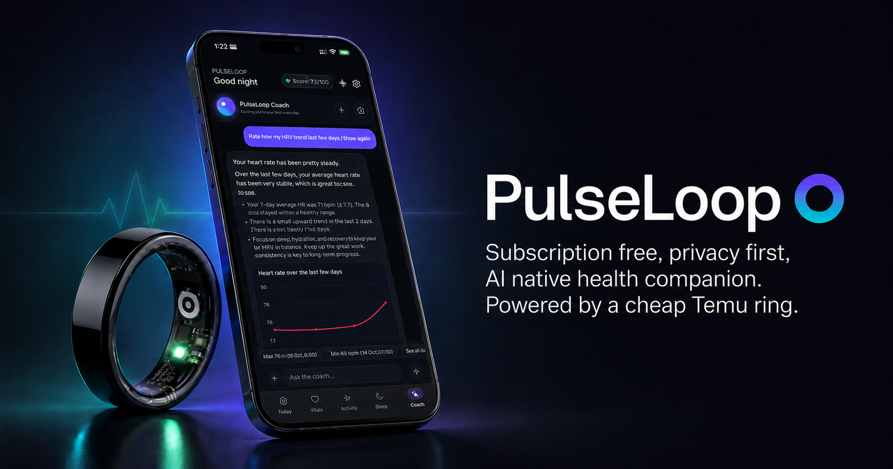

# PulseLoop Android

> ⚠️ **Важно:** приложение предоставляется «как есть» и не является медицинским.
> Кольца — не медицинские устройства. Приложение не заменяет врача: по любым
> вопросам здоровья обращайтесь к специалисту.

PulseLoop Android — порт [PulseLoop для iOS](https://github.com/saksham2001/PulseLoopiOS):
приложения-компаньона для недорогих смарт-колец на платформах 56ff/Jring и Colmi/Yawell QRing.
Приложение работает с кольцом напрямую по Bluetooth, без облака производителя и без аккаунта,
и добавляет поверх ваших данных ИИ-коуча. Полная документация — в [README на английском](README.md).

<p align="center">
  
</p>

## Русский язык в приложении

- **Весь интерфейс**: экраны «Сегодня», «Показатели», «Сон», «Активность», «Коуч»,
  настройки и все их разделы, онбординг, подключение кольца, питание, тренировки, виджеты.
- **Уведомления**: сводки коуча, низкий заряд кольца, тренировка в реальном времени.
- **Описания зон и показателей**: нормы пульса, SpO₂, ВСР, давления, глюкозы, температуры,
  стресса и усталости, а также анализ сна.
- **ИИ-коуч отвечает по-русски.** Промпты и описания инструментов остались на английском:
  модели надёжнее работают с ними в оригинале, а часть ответов разбирается по точным
  английским токенам. К каждому системному промпту добавляется указание писать ответ на
  языке приложения. Это касается чата, карточек-сводок, уведомлений и ИИ-оценки еды.
- **Даты и время** выводятся по правилам языка: 24-часовой формат и порядок «11 нояб.».
- Склонение по числам (`1 шаг`, `3 шага`, `5 шагов`) сделано через plurals.

Остались на английском: экран для разработчиков (Debug), технические заметки автоопределения
локального LLM-сервера, названия моделей и их описания, а также журналы и экспорт
диагностики — они нужны для отчётов об ошибках в оригинальном проекте.

## Язык приложения

Язык берётся из системы. Если телефон на русском, приложение тоже будет на русском. В остальных
случаях оно останется на английском. На Android 13+ язык можно выбрать отдельно для приложения:
**Настройки Android → Приложения → PulseLoop → Язык**.

## Подключение кольца

1. При первом запуске мастер настройки проведёт через подключение: пролистайте карусель до
   своей модели и нажмите **«Подключить кольцо»**.
2. Если мастер уже пройден, откройте **«Настройки»** и нажмите карточку устройства вверху.
3. Держите кольцо рядом и «разбудите» его (ненадолго снимите с зарядки), затем выберите его
   в списке найденных.
4. Кольцо подключится, синхронизирует историю, и показатели начнут заполняться.

### Профиль и калибровка

Кольцам **56ff/Jring** для точной оценки сахара в крови и калорий нужен ваш профиль:
**возраст, рост, вес и пол**. Их можно указать при первой настройке или в
**«Настройки → Профиль»**. Данные хранятся **только на телефоне**.

Давление измеряется датчиком напрямую, и профиль для него не нужен. Кольцам **Colmi**
профиль не нужен вообще: давление и сахар они не поддерживают.

Для 56ff/Jring можно откалибровать давление по тонометру, а сахар — по результату анализа
или глюкометра: **«Настройки → Калибровка»**. Раздел показывается только для колец, которые
поддерживают эти показатели.

## Поддержка колец

| Возможность | 56ff / Jring | Colmi QRing |
|---|---|---|
| Пульс (разовый замер, в реальном времени, история) | ✅ | ✅ |
| SpO₂ (разовый замер, история) | ✅ | ✅ |
| Шаги, расстояние, калории | ✅ | ✅ |
| Сон (лёгкий, глубокий, бодрствование) | ✅ | ✅ |
| Сон (REM) | ❌ | ✅ |
| Давление | ✅ | ❌ |
| Сахар в крови | ✅ | ❌ |
| ВСР | ❌ | ✅ |
| Стресс | ✅ | ✅ |
| Усталость | ✅ | ✅ |
| Температура кожи | ❌ | ✅ |
| Заряд батареи | ✅ | ✅ |
| Поиск устройства | ✅ | ✅ |

Полный список моделей, особенности протоколов и раздел про диагностику — в
[README на английском](README.md).

## Известные проблемы

- **«Забыть кольцо» может не до конца очистить стек Bluetooth.** Тогда при следующем поиске
  кольцо не видно ни PulseLoop, ни другим приложениям. **Помогает перезагрузка телефона.**

## Сборка

```bash
./gradlew assembleDebug
```

Минимальная версия: Android 8.0 (SDK 26).

## Как устроен перевод (для разработчиков)

- Строки лежат в `app/src/main/res/values/strings.xml` (английский) и
  `app/src/main/res/values-ru/strings.xml` (русский).
- В Composable-функциях используется `stringResource(...)` / `pluralStringResource(...)`.
- Коду без `Context` (сервисы, построители состояния, движок порогов) строки отдаёт
  `com.pulseloop.util.L10n`. В приложении он берёт их из ресурсов, а в JVM-юнит-тестах читает
  английский `values/strings.xml`, поэтому тесты с английскими строками проходят без изменений.
- Даты форматирует `com.pulseloop.util.LocaleFormats` по шаблонам-«скелетам» Android.
- Язык ответов ИИ задаёт `com.pulseloop.coach.context.CoachLanguage` по строке `coach_language`
  из того перевода, который Android реально выбрал. Если для языка телефона перевода нет,
  интерфейс и коуч остаются на английском.

Чтобы добавить ещё один язык, создайте `values-<код>/strings.xml` (в `coach_language` укажите
английское название языка, например `German`) и добавьте код в `res/xml/locales_config.xml`.

## Лицензия

См. [README](README.md) и [родительский проект](https://github.com/saksham2001/PulseLoopiOS).
